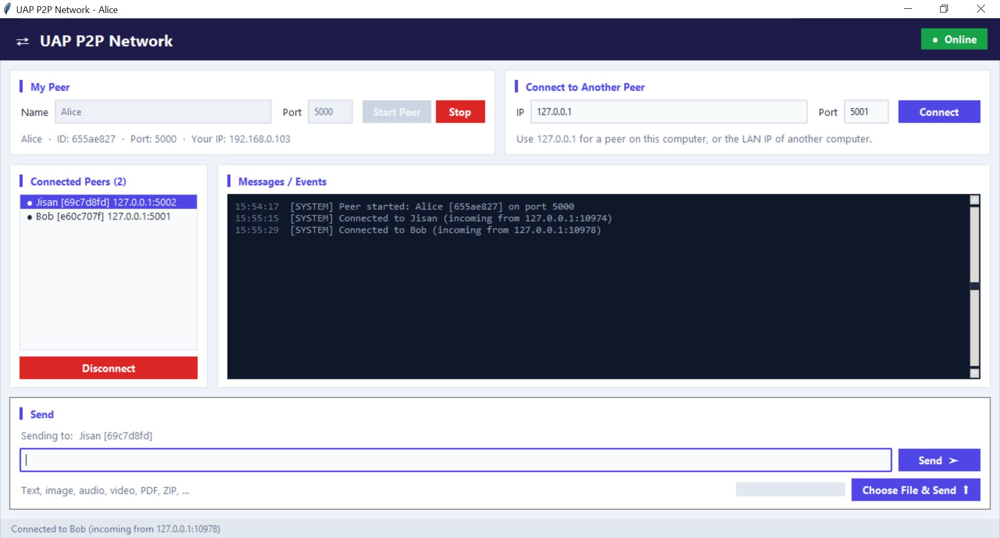
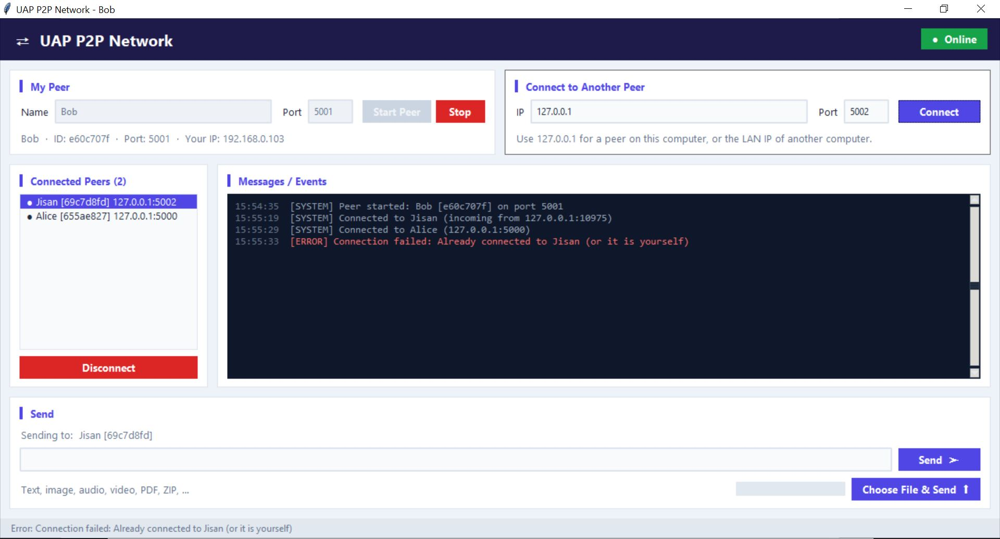
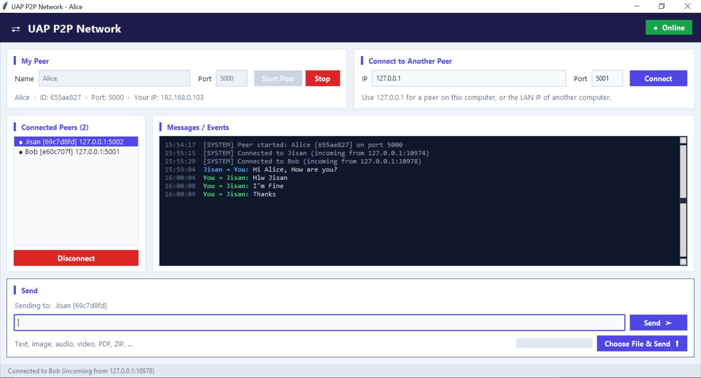
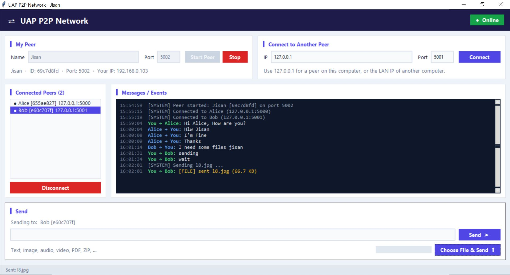

# Peer-to-Peer Network: Communication and File Sharing

**Course:** CSE 433 – Blockchain & Distributed Security Lab
**Institution:** Department of CSE, University of Asia Pacific
**Language:** Python 3 (standard library only) · **Communication:** TCP sockets · **GUI:** Tkinter

## Project Description

A lightweight peer-to-peer (P2P) application written in Python. Each running copy of the
program is one **peer**, and every peer is both a **TCP server** (it accepts incoming connections) and a
**TCP client** (it connects to other peers). Peers connect directly to each other with an IP address and a
port, then exchange **text messages** and **files of any type** (text, images, audio, video, PDF, ZIP, …).
There is no central server.

```
Peer A
  ↓  IP address + port
TCP socket
  ↓
HELLO handshake (hello / hello_ack)
  ↓
Application protocol ([4-byte length][JSON])
  ↓
Text / file data
  ↓
Peer B
```

### Features
- Start a peer with a name and a listening port. A random 8-character peer ID is generated.
- Connect to any peer by IP address and port.
- A HELLO / HELLO_ACK handshake lets both sides learn each other's ID, name and listening port.
- A list of connected peers, shown as `Name [id] ip:port`.
- Text messages to the selected peer.
- File transfer for any file type. Every file is treated as raw binary data and sent in 64 KB chunks.
- Received files are saved in `downloads/`. If a file with the same name already exists, the new file is saved as `name (1).ext`.
- Multiple peers at the same time, with one thread per connection.
- A progress bar for file transfers and a colour-coded, timestamped message/event log.
- A responsive GUI. In a narrow window the layout switches to a single column, and the Send controls stay
  visible at any window size.
- Errors are handled without crashing: invalid IP or port, a port already in use, connection refused, a peer
  that is not running, a peer that disconnects unexpectedly, a file that does not exist, an invalid file size, and sending without selecting a peer.

## Screenshots

The demo used three peers on one computer:

| Peer  | Port | Peer ID    |
|-------|------|------------|
| Alice | 5000 | `655ae827` |
| Bob   | 5001 | `e60c707f` |
| Jisan | 5002 | `69c7d8fd` |

Jisan connected to Alice and Bob, and Bob connected to Alice, so every peer is directly connected to the other
two. There is no central server.

```
        Alice (5000)
        /               /           Bob (5001) ---- Jisan (5002)
```

### 1. Peers started and connected (HELLO handshake)

**Peer 1 – Alice:** Alice is listening on port 5000. Jisan and Bob both connected to her (*incoming*
connections), and her peer list shows both of them with their IDs.



**Peer 2 – Bob:** Bob was connected to by Jisan and then connected to Alice himself. When he tried to connect
to Jisan a second time, the app rejected the duplicate connection with an error and kept running.



**Peer 3 – Jisan:** Jisan connected to Alice (`127.0.0.1:5000`) and Bob (`127.0.0.1:5001`), so this peer is
acting as a client to both of them.


### 2. Text messaging

**Jisan → Alice:** Jisan selects Alice in the peer list and sends *"Hi Alice, How are you?"*.


**Alice → Jisan:** Alice receives the message (blue = incoming) and replies (green = outgoing).



### 3. File transfer and multiple peers

**Jisan → Bob:** Jisan is chatting with both Alice and Bob at the same time. Bob asks for a file, so Jisan selects
Bob and uses **Choose File & Send** to send an image (`l8.jpg`, 66.7 KB). The file is saved in Bob's
`downloads/` folder.



## Project Structure

```
P2P_Network/
|-- main.py           # Tkinter user interface
|-- p2p_node.py       # Networking: server, client, handshake, text, file transfer
|-- protocol.py       # Message framing and message types (encode/decode)
|-- requirements.txt  # No third-party packages
|-- downloads/        # Received files are stored here
|-- screenshots/      # Screenshots used in this README
`-- README.md
```

## Requirements
- Python **3.9 or later**
- Tkinter (included with the standard Python installers for Windows and macOS. On Debian/Ubuntu Linux run
  `sudo apt install python3-tk`.)
- Windows, Linux or macOS
- To test on several computers, all of them must be on the **same LAN or Wi-Fi network**.

## Installation / Setup
1. Install Python 3.9+ from <https://www.python.org>.
2. Download the project, either by cloning this repository:
   ```bash
   git clone <this-repository-url>
   cd <repository-folder>
   ```
   or by clicking **Code → Download ZIP** on GitHub and extracting the ZIP.
3. No `pip install` is needed, because the project only uses the standard library.

## How to Run

```bash
python main.py
```

1. Enter a **Name** (for example `Alice`) and a **Port** (for example `5000`).
2. Click **Start Peer**. The info line shows your peer ID, your port and **your LAN IP**. Other peers use that IP and port to connect to you.

## How to Connect Two Peers

### On one computer
Open two terminals and run `python main.py` in each.

| Window | Name  | Port |
|--------|-------|------|
| 1      | Alice | 5000 |
| 2      | Bob   | 5001 |

In Bob's window, type IP `127.0.0.1` and port `5000`, then click **Connect**. Both windows now show the other
peer under **Connected Peers**.

> Each peer on the same computer needs its own port, because only one program can listen on a given port at a time.

### On two or more computers (same Wi-Fi/LAN)
1. Start a peer on each computer. Each window shows its own IP, for example `Your IP: 192.168.1.10`.
2. On computer B, type computer A's IP and port, for example `192.168.1.10` and `5000`, then click **Connect**.
3. If the connection is refused or times out, allow Python through the **firewall** (on Windows, choose "Allow
   access" on Private networks when the prompt appears).

### Multiple peers
Start Alice (5000), Bob (5001) and Charlie (5002). Connect Bob to Alice, Charlie to Bob, and Charlie to
Alice. Each peer now lists the other two and can talk to either of them.

## How to Send Messages and Files
1. Select a peer in **Connected Peers**. If only one peer is connected, it is selected automatically.
2. **Text:** type a message and press **Send** (or Enter).
3. **File:** click **Choose File & Send** and choose any file. The progress bar shows the transfer.
4. The receiver's log shows `File received: <name>`, and the file is saved in the receiver's `downloads/` folder.

## Communication Protocol

### Message framing
TCP is a byte stream and does not keep message boundaries, so every JSON message is prefixed with its length:

```
+----------------+----------------------+
| 4-byte length  |     JSON payload     |
+----------------+----------------------+
```
The length is an unsigned 32-bit big-endian integer (`struct.pack("!I", n)`). The receiver reads exactly 4
bytes, then exactly *n* bytes (`recv_exact()` in `protocol.py`).

### Message types
```json
{"type": "hello",     "peer_id": "a83f21c4", "peer_name": "Alice", "port": 5000}
{"type": "hello_ack", "peer_id": "92bd71e3", "peer_name": "Bob",   "port": 5001}
{"type": "text", "sender_id": "a83f21c4", "sender_name": "Alice", "message": "Hello Bob!"}
{"type": "file", "sender_id": "a83f21c4", "sender_name": "Alice", "filename": "photo.jpg", "filesize": 2456789}
```

### File transfer
1. The sender sends the `file` metadata message.
2. The sender then sends the **raw file bytes**, read and sent in 64 KB chunks so a large file never has to fit in memory.
3. The receiver reads **exactly `filesize` bytes**, then writes them to `downloads/<filename>`. It does not
   assume that one `recv()` call returns the whole file.
4. Each connection has a send lock, so the bytes of a file can never be mixed with another message sent at the
   same time.

### Threads
- **Accept thread:** runs `accept()` in a loop and starts a new thread for each incoming connection.
- **One receive thread per peer:** reads messages and files from that peer.
- **Background threads** for `connect()` and file sending, so the window stays responsive.
- Network threads send events to the GUI through a `queue.Queue`, which the GUI reads every 100 ms. This is
  needed because Tkinter is not thread-safe.

## Testing Performed
- Manual demo with three peers (Alice, Bob, Jisan): connections, the peer lists, chat, and an image transfer.
  See [Screenshots](#screenshots).
- Same computer, 3 peers (ports 5100–5102): the handshake, the peer lists, and text messages in all directions.
- A 20 MB random binary file sent to two peers at the same time arrived **byte-identical** (SHA-256 verified).
- A text message sent during a file transfer did not corrupt the file.
- A zero-byte file was transferred correctly.
- Error cases: invalid IP, invalid port, port already in use, connection refused, duplicate connection,
  connecting to yourself, a missing file, no peer selected, and a peer that disconnects unexpectedly. Each one
  shows an error message and the app keeps running.
